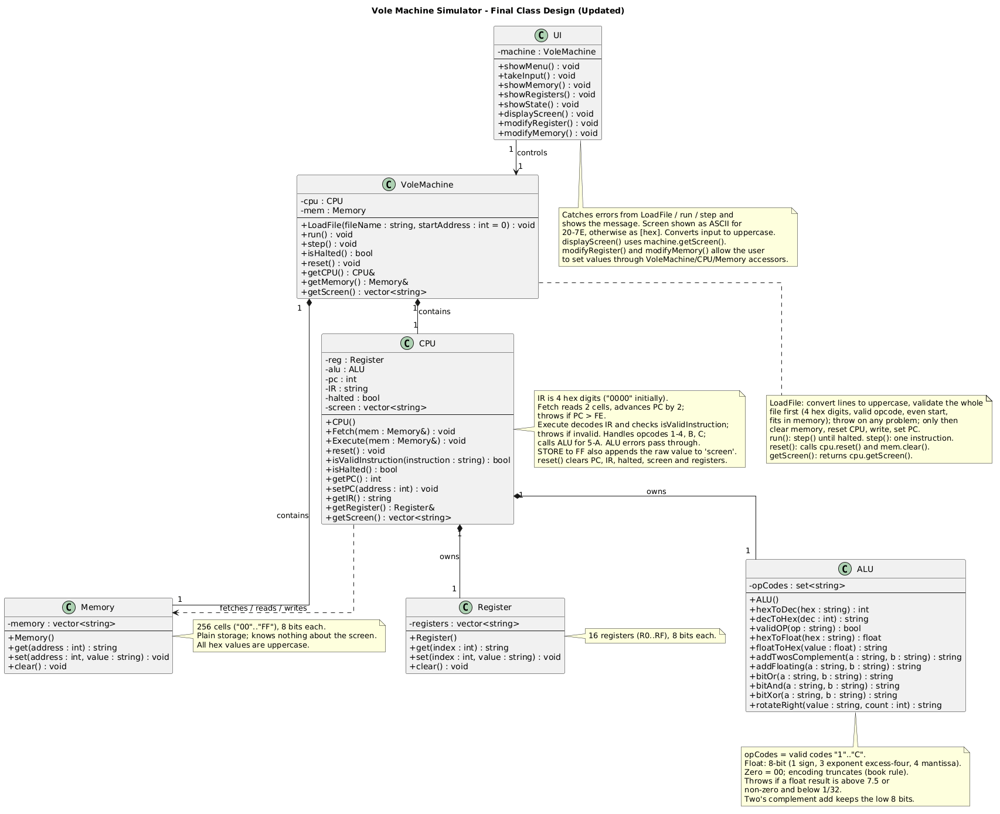

# Vole Machine Simulator

A console simulator for the Vole machine described in Appendix C of Brookshear's *Computer Science: An Overview*. It loads a program from a text file, runs it (all at once or one instruction at a time) and lets you inspect and edit registers and memory. Written in C++.

## Team

* [Bavly Boules](https://github.com/bavlybbb12)
* [Bemwa Bakhet](https://github.com/Boggos009)
* [Carol Ebied](https://github.com/CarolEbied)
* [Youssef Romany](https://github.com/youssefromany443-web)

## The machine

- 16 registers (`0`-`F`), 8 bits each
- 256 memory cells (`00`-`FF`), 8 bits each
- 16-bit instructions stored in two consecutive cells, so programs start at an even address
- Program counter (PC) and instruction register (IR)
- Cycle: fetch (read two cells into IR, PC += 2), then execute

Project rule not in the book: storing a value at address `FF` also sends it to the screen.

### Instruction set

| Opcode | Operand | Action |
|--------|---------|--------|
| 1 | `RXY` | Load register R from memory cell XY |
| 2 | `RXY` | Load register R with the value XY |
| 3 | `RXY` | Store register R in memory cell XY (XY = `FF` also prints to screen) |
| 4 | `0RS` | Copy register R to register S |
| 5 | `RST` | R = S + T (two's complement, wraps at 8 bits) |
| 6 | `RST` | R = S + T (floating point) |
| 7 | `RST` | R = S OR T |
| 8 | `RST` | R = S AND T |
| 9 | `RST` | R = S XOR T |
| A | `R0X` | Rotate register R right X bits (circular) |
| B | `RXY` | If register R equals register 0, PC = XY |
| C | `000` | Halt |

Floating point uses the 8-bit format from section 1.7: 1 sign bit, 3 exponent bits (excess-four), 4 mantissa bits. Results are truncated, not rounded. A result above 7.5 or a non-zero result below 1/32 raises an error.


## Usage
The Menu:

```
1. Load Program from File
2. Run Program Continuously
3. Execute Single Step
4. Show Registers
5. Show Memory
6. Show Full Machine State
7. Modify Register
8. Modify Memory
9. Reset Machine
0. Exit
```

To run a program: choose 1, enter the file path and a start address in hex (for example `00`), then choose 2 to run it or 3 to step through it. Option 6 shows PC, IR, registers, the memory matrix and the screen output.


## Design



| Class | Responsibility |
|-------|----------------|
| `UI` | Menu, input checking, display. Catches errors thrown by the machine. |
| `VoleMachine` | Owns CPU and memory. Loads files, `run()`, `step()`, `reset()`. |
| `CPU` | Fetch and execute. Handles opcodes 1-4, B, C; sends 5-A to the ALU. Owns the PC, IR, halt flag and screen list. |
| `ALU` | Arithmetic, logic and rotation, plus hex/decimal/float conversion and the valid opcode set. |
| `Memory` | 256 cells of plain storage. Throws on a bad address or value. |
| `Register` | 16 cells of plain storage. |

All values are stored as uppercase two-digit hex strings. Errors are reported by throwing exceptions.
